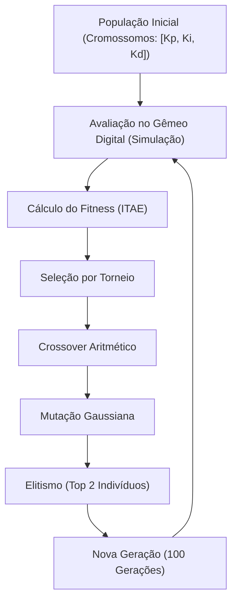

# 🧬 Algoritmo Genético & Otimização Evolutiva

Arquitetura do algoritmo genético desenvolvido *from scratch* em NumPy para exploração do espaço de busca dos parâmetros PID.

---

## ⚙️ Operadores Evolutivos Implementados

---

## 📐 Função de Aptidão (Fitness ITAE)

Para avaliar a qualidade de cada trio de ganhos $[K_p, K_i, K_d]$, o algoritmo utiliza o critério **ITAE (Integral of Time-weighted Absolute Error)**:

$$\text{ITAE} = \int_0^{t_{\text{sim}}} t \cdot |e(t)| \, dt$$

### Vantagens do ITAE para Sistemas Térmicos:
1. **Penalização Ponderada pelo Tempo:** Erros que persistem por longos períodos recebem um peso exponencialmente maior devido à multiplicação por $t$.
2. **Eliminação de Oscilação:** Força a convergência rápida para o setpoint e suprime o *overshoot* e o *ringing*.

---

[[02 - Projetos/Genetic-PID-Tuning/MAIN|Hub Genetic PID Tuning]] | [[02 - Ganhos Ótimos & Resposta ao Degrau|Ganhos Ótimos & Resposta ao Degrau]] | [[00 - Índice Principal]]

