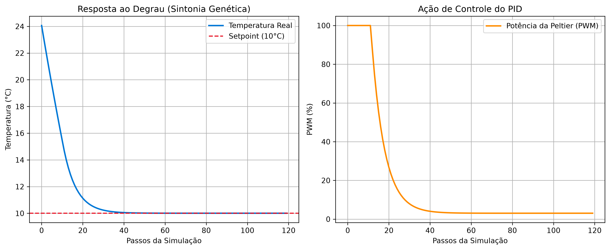

# 🧬 Data-Driven PID Tuning: Algoritmo Genético para Gêmeos Digitais Térmicos


> 🔗 **Projeto Complementar:** Este repositório foca na Inteligência Artificial e Controle Preditivo. Ele foi desenvolvido como uma extensão analítica para o hardware físico documentado no repositório **[Thermal-Freezer-IoT](https://github.com/murilo-lameira/Thermal-Freezer-IoT)**. Os dados térmicos (Telemetria) utilizados para treinar os modelos deste repositório foram extraídos diretamente do hardware original construído com ESP32, sensores OneWire e pastilha Peltier.

## 🎯 Objetivo do Projeto
Na engenharia de controle, sistemas térmicos possuem elevado atraso de transporte e inércia. Sintonizar os parâmetros Proporcional, Integral e Derivativo (Kp, Ki, Kd) empiricamente consome muito tempo e energia. 

Este projeto substitui a sintonia manual por uma abordagem orientada a dados:
1. **Digital Twin (Gêmeo Digital):** Treinamento de um modelo matemático preditivo baseado no histórico de telemetria IoT real (PWM aplicado vs. Temperatura real).
2. **Genetic Algorithm (Otimização Evolutiva):** O gêmeo digital é submetido a uma evolução de 100 gerações em um ambiente virtual. O algoritmo testa dezenas de PIDs e avalia o fitness usando a métrica **ITAE (Integral do Tempo e Erro Absoluto)** para penalizar instabilidades e *overshoots*.

## 🛠️ Stack Tecnológico
* **Linguagem:** Python
* **Machine Learning:** `scikit-learn` (Regressão Linear Múltipla / FOPDT)
* **Algoritmo Genético:** `numpy` (Desenvolvido *from scratch* com Seleção por Torneio, Crossover Aritmético e Mutação)
* **Manipulação de Dados:** `pandas`
* **Visualização:** `matplotlib`

## 📊 Resultados e Validação

O modelo preditivo (Gêmeo Digital) atingiu **99.7% de precisão (R²)** com margem de erro térmica de apenas **0.38°C** em relação ao comportamento físico da pastilha Peltier real.

Após a evolução genética de 100 gerações, a IA convergiu para os seguintes ganhos ideais para garantir a estabilidade do sistema sem flutuações e minimizar o esforço de controle:
* `Kp = 22.26` (Resposta rápida para quebrar a inércia térmica)
* `Ki = 0.02` (Prevenção de *Windup* integral)
* `Kd = 3.55` (Amortecimento derivativo para pouso suave no *setpoint*)


> *A resposta ao degrau gerada comprova a estabilidade do sistema virtual, cravando o erro de regime em zero sem overshoot, mesmo lidando com a alta latência térmica.*

## 🚀 Como Executar

1. Clone o repositório:
```bash
git clone [https://github.com/seu-usuario/tuning-pid-genetico.git](https://github.com/seu-usuario/tuning-pid-genetico.git)